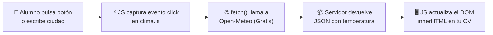

# 🚀 Guía Didáctica Integral: De la Infografía a la Web Viva
## Introducción a APIs, JavaScript Moderno y Manipulación del DOM (Con Caso Práctico en tu CV)

> **Destinatarios:** Alumnos del Máster / Grado en Informática, Business Analytics, Big Data e IA.  
> **Objetivo:** Comprender qué es una API, cómo se comunica un navegador con el resto de Internet usando JavaScript asíncrono (`fetch`), cómo se inyectan esos datos vivos en la pantalla a través del DOM (*Document Object Model*) y **cómo integrar un widget de clima en tu propio CV en menos de 10 minutos**.  
> **Material visual de apoyo:** Colección de 20 láminas ilustradas ubicadas en esta misma carpeta (`llamadas_api_project/`).

---

## 🗺️ Mapa de Contenidos

1. [El Hilo Conductor: La Gran Metáfora del Restaurante](#-el-hilo-conductor-la-gran-met%C3%A1fora-del-restaurante)
2. [Desglose Didáctico Lámina a Lámina (Las 20 Láminas Explicadas)](#-desglose-did%C3%A1ctico-l%C3%A1mina-a-l%C3%A1mina)
   * [Fase 1: La chispa y el motor (Láminas 1 a 5)](#fase-1-la-chispa-y-el-motor)
   * [Fase 2: El tiempo, la red y la espera sin bloqueo (Láminas 6 a 10)](#fase-2-el-tiempo-la-red-y-la-espera-sin-bloqueo)
   * [Fase 3: La misión del clima y pintar con el DOM (Láminas 11 a 15)](#fase-3-la-misi%C3%B3n-del-clima-y-pintar-con-el-dom)
   * [Fase 4: Herramientas profesionales, ecosistema y multimedia (Láminas 16 a 20)](#fase-4-herramientas-profesionales-ecosistema-y-multimedia)
3. [🎯 INFOGRAFÍA PASO A PASO: Añade el Tiempo a tu CV Personal en 10 Minutos](#-infograf%C3%ADa-paso-a-paso-a%C3%B1ade-el-tiempo-a-tu-cv-personal-en-10-minutos)
   * [El Esquema Mental en 30 Segundos](#el-esquema-mental-en-30-segundos)
   * [Paso 1: Añadir el HTML al CV (`index.html`)](#paso-1-a%C3%B1adir-el-html-al-cv-indexhtml)
   * [Paso 2: Darle Estilo con CSS (`styles-modified.css`)](#paso-2-darle-estilo-con-css-styles-modifiedcss)
   * [Paso 3: Crear el Script Asíncrono (`clima.js`)](#paso-3-crear-el-script-as%C3%ADncrono-climajs)
   * [Comprobación y Resolución Rápida de Errores Comunes](#comprobaci%C3%B3n-y-resoluci%C3%B3n-r%C3%A1pida-de-errores-comunes)

---

## 🍽️ El Hilo Conductor: La Gran Metáfora del Restaurante

Para no perderte entre siglas (API, DOM, HTTP, JSON, CORS), piensa en una visita a un restaurante:

```
[ CLIENTE EN LA MESA ]         [ EL CAMARERO (API) ]          [ LA COCINA (BACKEND) ]
   Tu Navegador Web    <--->      Petición HTTP       <--->    Servidor de Datos
(HTML + CSS + Botón)             (GET / Clima)               (Bases de datos / Satélites)
```

1. **Tú eres el comensal sentado a la mesa (El Navegador Web):** Tienes delante una carta con platos bonitos (tu **HTML y CSS**). Pero tú no tienes acceso directo a los fogones ni a las cámaras frigoríficas.
2. **El Camarero es la API (*Application Programming Interface*):** Es el intermediario oficial. Tú no entras a la cocina; llamas al camarero con una orden estructurada (*"Por favor, traiga el clima de Madrid"*).
3. **La Cocina es el Servidor Remoto (Backend / Base de Datos):** Procesa el pedido, consulta sus fuentes y prepara el plato.
4. **El Plato servido es el JSON:** El camarero regresa a tu mesa con una bandeja estandarizada que contiene únicamente los datos limpios.
5. **El DOM es tu tenedor y tu boca:** Tu código JavaScript toma los datos de la bandeja y los coloca en el plato exacto de tu mesa (un `<div>` o un `<p>`), cambiando la pantalla sin tener que levantarte ni rehacer el restaurante entero (sin recargar la página).

---

## 📖 Desglose Didáctico Lámina a Lámina

---

### Fase 1: La chispa y el motor

#### Lámina 1: La API: camarero de una gran cocina


* **Concepto fundamental:** Ninguna aplicación web moderna vive aislada. Una página web estática solo sabe lo que tú escribiste en su HTML el día que la creaste. Para saber qué tiempo hace hoy, qué precio tiene una acción en bolsa o cuántos seguidores tienes en GitHub, tu web necesita **hablar con el exterior**.
* **¿Qué significa API?** *Application Programming Interface*. Es un contrato: un conjunto de reglas, URLs y formatos con los que un sistema permite que otros programas se conecten a él de forma segura y controlada.
* **Lección para el alumno:** Cuando consultamos el clima en nuestro CV, no tenemos un termómetro enchufado al ordenador; llamamos a un servidor meteorológico que nos responde en milisegundos.

---

#### Lámina 2: JavaScript: el motor de la web


* **El triángulo fundamental de la web:**
  * **HTML:** El esqueleto (semántica, estructura, qué elementos existen).
  * **CSS:** El ropaje y la belleza (colores, tipografía, flexbox, márgenes).
  * **JavaScript:** El cerebro y los músculos (comportamiento, lógica, interactividad, red).
* **¿Por qué JS es único?** Es el único lenguaje de programación que los navegadores web ejecutan de forma nativa sin instalar nada adicional. Corre directamente en la máquina del usuario final.

---

#### Lámina 3: Del HTML al DOM: objetos manipulables


*(Véase también lámina de soporte: [Lámina 03_20: Cabeceras del navegador](3.%20La%CC%81mina%2003_20_%20cabeceras%20del%20navegador.png))*

* **¿Qué demonios es el DOM?** *Document Object Model*. Cuando el navegador lee tu archivo `index.html`, no trabaja con el texto plano; construye un **árbol genealógico de objetos vivos en la memoria RAM**:
  ```
                 window
                   │
                document
                   │
                <html>
               /      \
            <head>    <body>
                       /   \
                   <main>  <script>
                    /  \
                  <h1> <p id="clima">
  ```
* **El poder de JavaScript:** Gracias al DOM, JavaScript puede decir:  
  `const caja = document.getElementById("clima");`  
  y a partir de ese segundo, `caja` es un objeto vivo al que le puedes cambiar el texto (`caja.innerText = "22°C"`), el color, o meterle nuevo HTML (`caja.innerHTML = "<strong>Soleado</strong>"`).

---

#### Lámina 4: Eventos JavaScript: la página aprende a reaccionar


*(Véase también lámina de soporte: [Lámina 04_20: Código climático corregido](4.%20La%CC%81mina%2004_20_%20co%CC%81digo%20clima%CC%81tico%20corregido.png))*

* **El modelo guiado por eventos (*Event-Driven Architecture*):** En la web el código no se ejecuta todo en fila india de principio a fin. El código se queda dormido esperando a que el usuario haga algo:
  * Un clic del ratón (`click`).
  * Escribir en una caja de texto (`input` o `keydown`).
  * Que la página termine de cargarse (`DOMContentLoaded`).
* **La sintaxis mágica:**
  ```javascript
  const boton = document.getElementById("btn-consultar");
  boton.addEventListener("click", function() {
      // Este bloque SOLO se despierta cuando el usuario hace clic
      console.log("¡Han pulsado el botón!");
  });
  ```

---

#### Lámina 5: Const, let y var: etiquetas y cajas


* **La regla de oro moderna (ES6+):** Olvídate de `var` (provoca errores por *hoisting* y alcance difuso).
* **`const` (Por defecto):** Úsalo para todo lo que no vaya a ser reasignado (elementos del DOM, URLs de la API, funciones). Hace tu código predecible y seguro.
* **`let` (Solo cuando cambie):** Úsalo para contadores, acumuladores o variables cuyo valor varíe a lo largo del tiempo.

---

### Fase 2: El tiempo, la red y la espera sin bloqueo

#### Lámina 6: Dos segundos: una eternidad para el ordenador


* **La trampa del bloqueo sincrónico:** Un procesador moderno ejecuta miles de millones de instrucciones por segundo. Cuando le pides un dato a un servidor en EE.UU. o Japón, el paquete tarda unos 150 a 500 milisegundos en ir y volver.
* Si JavaScript esperase de forma síncrona ("congelando la ejecución"), **el navegador se quedaría totalmente congelado**: no podrías hacer scroll, no podrías hacer clic en ningún menú y la animación parecería rota.

---

#### Lámina 7: Async y await: esperar sin bloquear


* **La solución elegante de JavaScript:**
  * Declarar una función con `async` le dice al navegador: *"Esta función va a hacer operaciones que tardan tiempo"*.
  * La palabra `await` congela **únicamente esa función**, dejando libre al resto de la página para seguir animando, respondiendo al scroll y al ratón:
  ```javascript
  async function pedirDatos() {
      console.log("1. Empiezo a pedir");
      const respuesta = await fetch("https://api.ejemplo.com/datos"); // Espera en segundo plano
      console.log("2. Llegaron los datos");
  }
  ```

---

#### Lámina 8: Construir una URL con instrucciones


* **Anatomía de una petición web (Query Parameters):**
  ```
  https://api.open-meteo.com/v1/forecast?latitude=40.41&longitude=-3.70&current=temperature_2m
  └─── Dominio y ruta del endpoint ───┘ └── Signo ? ┘ └────────── Parámetros clave=valor ──────────┘
  ```
* Cada parámetro separado por `&` es una instrucción precisa para el servidor: qué coordenadas queremos, qué variable medir (`temperature_2m`) y en qué zona horaria.
* **Buenas prácticas:** Si el usuario teclea el nombre de una ciudad (con espacios o tildes), usa `encodeURIComponent(ciudad)` para que la URL sea siempre válida.

---

#### Lámina 9: HTTP: verbos para pedir acciones


* Los verbos principales del protocolo HTTP:
  * **`GET` (El que usamos aquí):** "Dame información, no voy a modificar nada en tu base de datos".
  * **`POST`:** "Aquí tienes datos nuevos, crea un registro".
  * **`PUT` / `PATCH`:** "Actualiza un dato existente".
  * **`DELETE`:** "Borra este registro".
* Por defecto, cuando ejecutas `fetch(url)` en JavaScript, estás enviando un `GET`.

---

#### Lámina 10: De HTTP a un objeto JavaScript


* **El gran viaje del texto:** Lo que viaja por los cables submarinos de fibra óptica es una corriente de bytes (texto plano codificado en UTF-8).
* Cuando recibes la respuesta HTTP, necesitas transformarla en algo que JavaScript entienda (un Objeto con propiedades):
  ```javascript
  const res = await fetch(url);      // Recibe los paquetes de red (cabeceras + flujo de bytes)
  const data = await res.json();     // Lee el texto completo y lo convierte en un Objeto JS real
  console.log(data.current.temperature_2m); // ¡Ya podemos acceder con punto como a cualquier objeto!
  ```

---

### Fase 3: La misión del clima y pintar con el DOM

#### Lámina 11: Primera parada: encontrar la ciudad


* **El problema de la geocodificación:** Los humanos pensamos en nombres ("Madrid", "Buenos Aires", "Pozuelo de Alarcón"). Los satélites y las APIs meteorológicas piensan en física y matemáticas: **Latitud y Longitud**.
* **Paso previo obligatorio:** Llamar primero a la API de Geocodificación de Open-Meteo:
  `https://geocoding-api.open-meteo.com/v1/search?name=Madrid&count=1`
* Nos devuelve: `{ latitude: 40.4168, longitude: -3.7038 }`. ¡Con esas dos cifras ya podemos pedir el tiempo exacto!

---

#### Lámina 12: Del mapa al termómetro


* **Cadena de dos llamadas (Composición de APIs):**
  ```
  [ Nombre: "Madrid" ] ──> (1. Geocoding API) ──> [ Lat: 40.41, Lon: -3.70 ]
                                                        │
  [ Temperatura: 18.4°C ] <── (2. Weather API) <────────┘
  ```
* En JavaScript unimos ambas llamadas con dos `await` consecutivos, de forma limpia y lineal.

---

#### Lámina 13: Pintar la respuesta con el DOM


*(Véase también lámina de soporte: [Lámina 13: Ajuste del panel climático en HTML](13.%20Ajuste%20del%20panel%20clima%CC%81tico%20en%20HTML.png))*

* Una vez que tenemos la cifra (ej. `18.4`), ¿cómo llega a los ojos del visitante?
  ```javascript
  const resultado = document.getElementById("resultado-clima");
  resultado.innerHTML = `🌤️ En Madrid hay <strong>${temp} °C</strong>`;
  ```
* El navegador detecta el cambio en el nodo del árbol DOM y repinta instantáneamente solo ese trozo de pantalla (*reflow/repaint* localizado).

---

#### Lámina 14: No todos los errores significan lo mismo


* **CUIDADO (Error típico de examen y de novato):** `fetch()` en JavaScript **NO falla ni salta al `catch` cuando el servidor devuelve un error 404 (No Encontrado) o 500 (Fallo del Servidor)**.
* Para `fetch()`, cualquier respuesta que llegue por la red es un éxito de comunicación.
* Por eso siempre debes comprobar:
  ```javascript
  if (!res.ok) {
      throw new Error(`Error en el servidor: Código ${res.status}`);
  }
  ```
* Solo saltará al bloque `catch` cuando haya un **fallo de red físico** (cable desconectado, DNS caído o bloqueo por CORS).

---

#### Lámina 15: CORS, cabeceras y el cronómetro del ejemplo


* **¿Qué es CORS?** *Cross-Origin Resource Sharing*. Es un escudo de seguridad del navegador. Por defecto, tu navegador prohíbe que una web en `midominio.com` pida datos en secreto a `banco.com`.
* Para que podamos usar una API pública desde JavaScript de forma gratuita, el servidor debe responder con la cabecera:
  `Access-Control-Allow-Origin: *`
* Open-Meteo la incluye, por lo que podemos usarla directamente sin necesidad de backend intermedio.

---

### Fase 4: Herramientas profesionales, ecosistema y multimedia

#### Lámina 16: curl: hablar con la API desde terminal


* Antes de escribir código JavaScript, los ingenieros prueban las APIs directamente en la consola con `curl`:
  ```bash
  curl -s "https://geocoding-api.open-meteo.com/v1/search?name=Madrid&count=1"
  ```
* Si funciona en `curl`, sabes que la API está viva y que cualquier problema posterior estará en tu código front-end.

---

#### Lámina 17: Postman: la petición a prueba


* **Postman:** La interfaz gráfica estándar de la industria para diseñar, probar y documentar llamadas a APIs con cabeceras, parámetros y payloads JSON.

---

#### Lámina 18: Ciudades de APIs que colaboran


* El software moderno no es un bloque monolítico: es una constelación de servicios especializados (Stripe para pagos, Mapbox para mapas, Auth0 para usuarios, Open-Meteo para clima).

---

#### Lámina 19: Protocolos, formatos y estilos


* Repaso de la orquesta: TCP/IP en la base, HTTP en el transporte, JSON en el mensaje, DOM en la memoria, CSS en la presentación.

---

#### Lámina 20: Música y clima en el navegador


*(Véase también lámina de soporte: [Lámina 20: Clase de reproducción aplicada al botón](20.%20Clase%20de%20reproduccio%CC%81n%20aplicada%20al%20boto%CC%81n.png))*

* El mismo JavaScript que llama a una API de clima es capaz de controlar la etiqueta `<audio>` de HTML5 (`audio.play()`, `audio.pause()`) y añadir clases CSS interactivas (`boton.classList.toggle("reproduciendo")`). ¡Todo es manipulación del DOM!

---

## 🎯 INFOGRAFÍA PASO A PASO: Añade el Tiempo a tu CV Personal en 10 Minutos

Aquí tienes la guía **directa al grano** para modificar tu proyecto `project_personal_CV/` e insertar un widget de clima dinámico que deslumbre en tu entrega sin atascarte ni un segundo.

### El Esquema Mental en 30 Segundos



---

### Paso 1: Añadir el HTML al CV (`index.html`)

Abre tu archivo [`project_personal_CV/index.html`](file:///Users/fjbanezares/IdeaProjects/Hands-On-HTML-and-CSS-Building-Real-World-Websites-and-Web-Apps/project_personal_CV/index.html).

1. **Inserta esta sección** dentro de tu `<div id="cv">`, por ejemplo justo después de tu `<header>` o de tu sección de contacto:

```html
        <!-- ============================================== -->
        <!-- WIDGET DEL TIEMPO CON API REST (NUEVO)         -->
        <!-- ============================================== -->
        <section id="widget-clima" class="seccion-clima">
            <h2>🌤️ Estado del Tiempo en Directo</h2>
            <div class="caja-clima-cv">
                <input type="text" id="ciudad-clima" value="Madrid" placeholder="Escribe tu ciudad...">
                <button type="button" id="btn-clima">Ver Clima</button>
            </div>
            <div id="resultado-clima" class="resultado-clima">
                Pulsa el botón para consultar el clima.
            </div>
        </section>
```

2. **Conecta el archivo JavaScript:** Ve al final del archivo `index.html` y, **justo antes de la etiqueta de cierre `</body>`**, añade la siguiente línea:

```html
    <!-- Enlace al script del clima -->
    <script src="clima.js"></script>
</body>
</html>
```

---

### Paso 2: Darle Estilo con CSS (`styles-modified.css`)

Abre tu archivo CSS [`project_personal_CV/styles-modified.css`](file:///Users/fjbanezares/IdeaProjects/Hands-On-HTML-and-CSS-Building-Real-World-Websites-and-Web-Apps/project_personal_CV/styles-modified.css) y añade al final estas pocas reglas para que quede bonito y moderno:

```css
/* ======================================================= */
/* ESTILOS DEL WIDGET DEL CLIMA (API REST)                 */
/* ======================================================= */
.seccion-clima {
    background: #f0f7ff;
    border: 2px solid #cce3fe;
    border-radius: 12px;
    padding: 16px 20px;
    margin: 20px 0;
}

.caja-clima-cv {
    display: flex;
    gap: 10px;
    margin-bottom: 12px;
}

.caja-clima-cv input {
    flex: 1;
    padding: 8px 12px;
    border: 1px solid #94c5fd;
    border-radius: 6px;
    font-size: 15px;
}

.caja-clima-cv button {
    background-color: #2563eb;
    color: white;
    border: none;
    padding: 8px 16px;
    border-radius: 6px;
    font-weight: 600;
    cursor: pointer;
    transition: background-color 0.2s ease;
}

.caja-clima-cv button:hover {
    background-color: #1d4ed8;
}

.resultado-clima {
    font-size: 15px;
    padding: 10px 14px;
    background: #ffffff;
    border-radius: 8px;
    border-left: 4px solid #2563eb;
    color: #1e293b;
}

.resultado-clima.error {
    border-left-color: #ef4444;
    color: #991b1b;
    background: #fef2f2;
}

.resultado-clima.exito {
    border-left-color: #10b981;
    color: #065f46;
    background: #ecfdf5;
}
```

---

### Paso 3: Crear el Script Asíncrono (`clima.js`)

Crea un archivo nuevo llamado exactamente `clima.js` dentro de la carpeta `project_personal_CV/` (al lado de tu `index.html`).

Copia y pega este código completo:

```javascript
/**
 * clima.js - Consulta sencilla a la API de Open-Meteo
 */
async function obtenerClima() {
    const input = document.getElementById("ciudad-clima");
    const resultado = document.getElementById("resultado-clima");

    // 1. Obtener la ciudad que escribió el usuario (por defecto "Madrid")
    const ciudad = (input.value.trim() !== "") ? input.value.trim() : "Madrid";

    // 2. Avisar al usuario en pantalla de que la petición está en camino
    resultado.className = "resultado-clima";
    resultado.innerHTML = `⏳ Consultando el clima para <strong>${ciudad}</strong>...`;

    try {
        // PASO A: Convertir el nombre de la ciudad a Latitud y Longitud
        const geoUrl = `https://geocoding-api.open-meteo.com/v1/search?name=${encodeURIComponent(ciudad)}&count=1&language=es&format=json`;
        const resGeo = await fetch(geoUrl);
        
        if (!resGeo.ok) throw new Error("Fallo al conectar con el servicio de mapas.");

        const dataGeo = await resGeo.json();

        // Validar si la ciudad existe
        if (!dataGeo.results || dataGeo.results.length === 0) {
            resultado.className = "resultado-clima error";
            resultado.innerHTML = `❌ No se encontró la ciudad "<strong>${ciudad}</strong>". Revisa cómo está escrita.`;
            return;
        }

        const { latitude, longitude, name, country } = dataGeo.results[0];

        // PASO B: Con las coordenadas, pedir la temperatura actual
        const weatherUrl = `https://api.open-meteo.com/v1/forecast?latitude=${latitude}&longitude=${longitude}&current=temperature_2m&timezone=auto`;
        const resWeather = await fetch(weatherUrl);

        if (!resWeather.ok) throw new Error("El servidor meteorológico no responde.");

        const dataWeather = await resWeather.json();
        const temperatura = dataWeather.current.temperature_2m;
        const unidad = dataWeather.current_units.temperature_2m;

        // PASO C: Pintar el resultado feliz en el DOM
        resultado.className = "resultado-clima exito";
        resultado.innerHTML = `📍 En <strong>${name} (${country || ""})</strong> hay actualmente <strong>${temperatura} ${unidad}</strong> 🌤️`;

    } catch (error) {
        // Control de fallos de red (sin conexión a Internet)
        resultado.className = "resultado-clima error";
        resultado.innerHTML = `⚠️ Error de conexión: ${error.message}`;
    }
}

// Escuchar el evento click del botón cuando el HTML esté cargado
document.addEventListener("DOMContentLoaded", () => {
    const boton = document.getElementById("btn-clima");
    const input = document.getElementById("ciudad-clima");

    if (boton) {
        boton.addEventListener("click", obtenerClima);
    }

    // Permitir pulsar 'Enter' dentro del input
    if (input) {
        input.addEventListener("keydown", (e) => {
            if (e.key === "Enter") obtenerClima();
        });
    }

    // Consulta automática inicial al abrir el CV
    obtenerClima();
});
```

---

### Comprobación y Resolución Rápida de Errores Comunes

| Síntoma | Causa más probable | Solución rápida |
| :--- | :--- | :--- |
| **Hago clic y no pasa nada** | El script no está enlazado o el ID no coincide | Abre la consola del navegador pulsando **F12** (o botón derecho -> Inspeccionar -> Pestaña *Consola*). Comprueba que el `<script src="clima.js"></script>` está justo antes de `</body>`. |
| **Error: `Cannot read properties of null`** | El script se ejecutó antes de que existiera el botón en el HTML | Asegúrate de tener el código dentro de `document.addEventListener("DOMContentLoaded", ...)` o el `<script>` al final del `<body>`. |
| **La ciudad no se encuentra** | Ciudad con errata o caracteres extraños | Prueba con ciudades capitales conocidas ("Sevilla", "Tokyo", "Paris", "London"). |
| **Todo funciona pero sale feo** | No se añadieron las clases al CSS | Comprueba que guardaste los cambios en `styles-modified.css` y que el archivo CSS está enlazado en el `<head>`. |

¡Y listo! En 3 pasos y menos de 10 minutos tienes tu CV con datos reales de satélites meteorológicos en vivo. 🚀

